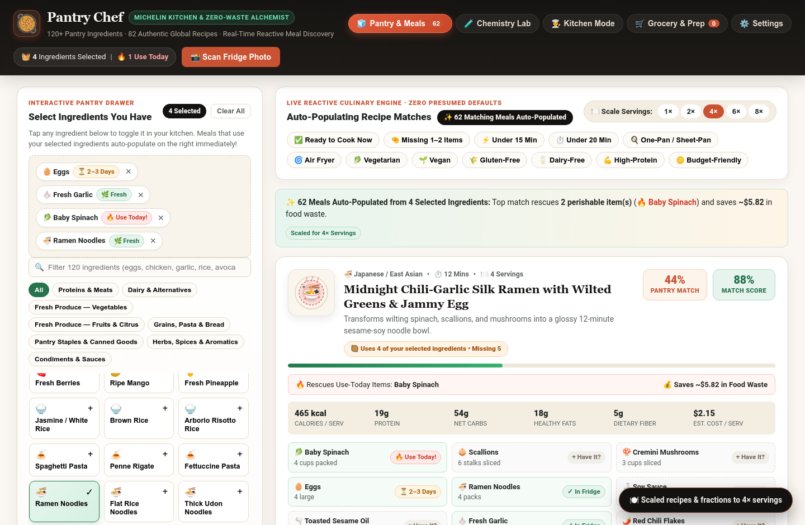
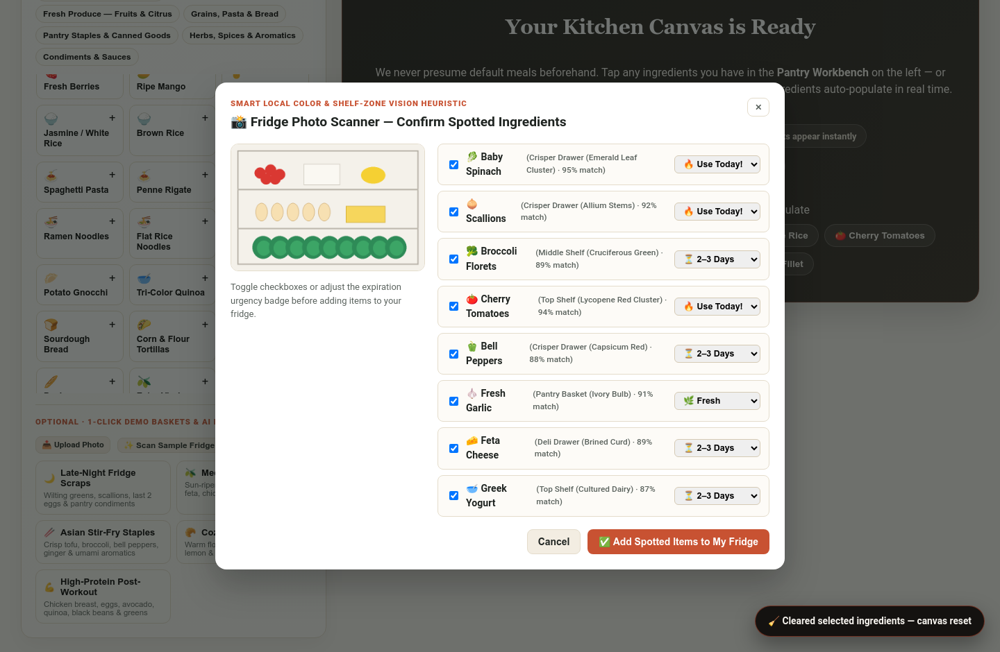
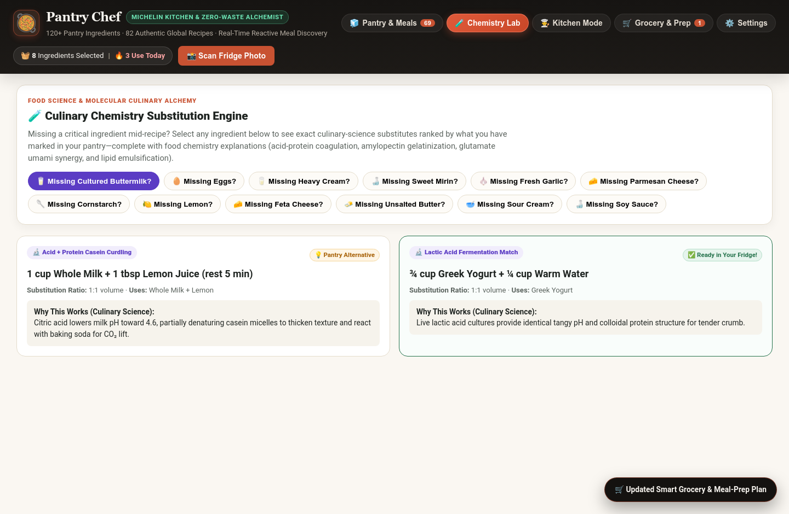
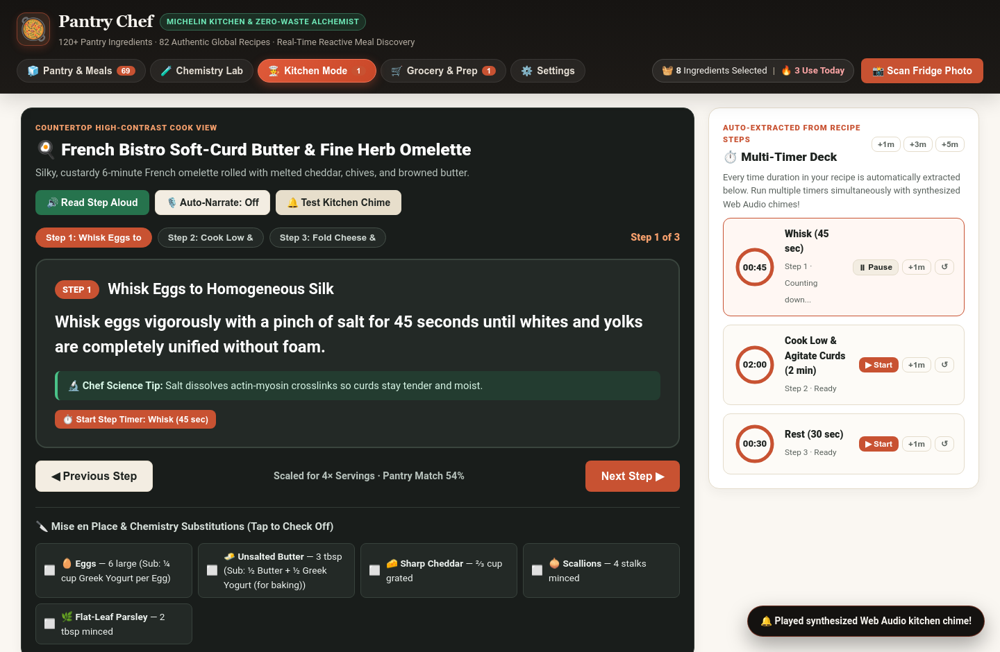
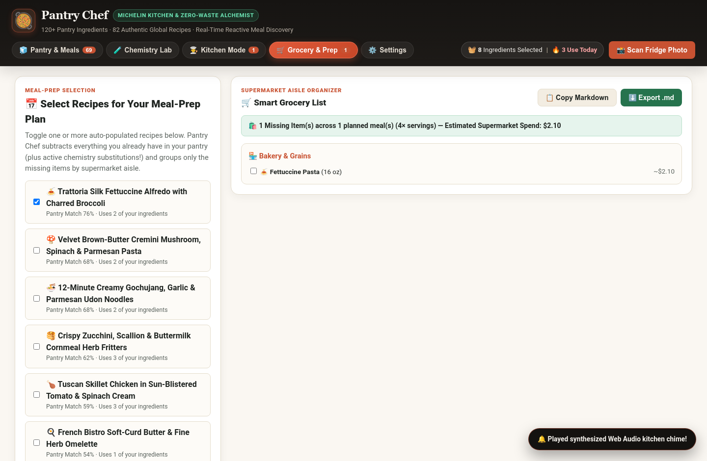
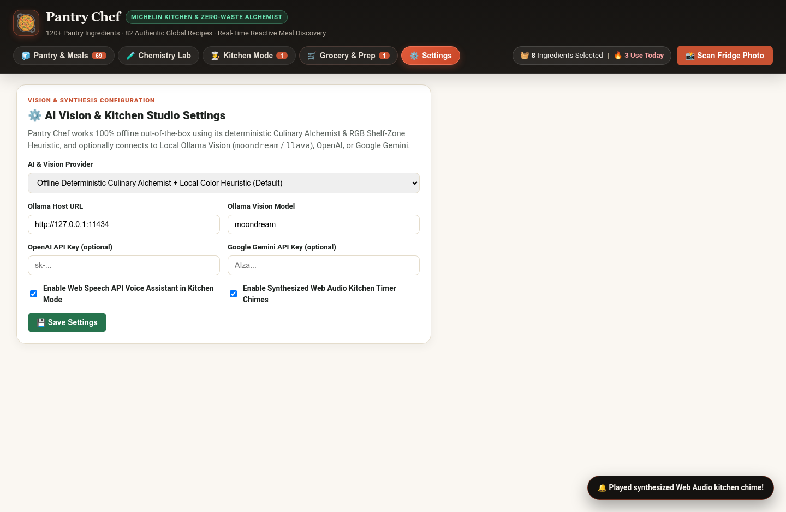

# 🥘 Pantry Chef (`pantry-chef`)

**Visual "What's in My Fridge?" Recipe Alchemist, Culinary Chemistry Substitution Engine & Hands-Free Multi-Timer Kitchen Studio**

Pantry Chef (`pantry-chef`, default port **`8095`**) turns expiring produce, half-used jars, and everyday pantry staples into restaurant-worthy meals while eliminating household food waste.

---

## ✨ Key Capabilities

1. **Visual Fridge/Pantry Inventory & Photo Scanner**:
   - **5 One-Click Quick Presets**: *🌙 Late-Night Fridge Scraps*, *🫒 Mediterranean Pantry*, *🥢 Asian Stir-Fry Staples*, *🥐 Cozy Sunday Baking*, and *💪 High-Protein Post-Workout*.
   - **48+ Visual Ingredient Chips** across 6 categories (*Produce*, *Proteins*, *Dairy & Eggs*, *Grains & Pasta*, *Canned & Jarred*, *Spices & Condiments*) with **Expiration Urgency Badges** (`🔥 Use Today!`, `⏳ 2–3 Days`, `🌿 Fresh`).
   - **Fridge Photo Upload & Vision Scanner**: Supports Local Ollama Vision (`moondream` / `llava`), OpenAI/Gemini Vision, and a deterministic **Smart Local Color & Shelf-Zone Heuristic** with an interactive Confirmation Modal.
   - **9 Dietary, Time & Equipment Filters**: *Under 15 Min*, *One-Pan / Sheet-Pan*, *Air Fryer*, *Vegetarian*, *Vegan*, *Gluten-Free*, *Dairy-Free*, *High-Protein*, and *Budget-Friendly*.

2. **Smart Recipe Alchemist, Waste-Saver Score & Chemistry Substitution Engine**:
   - Ranks and synthesizes recipes that **maximize expiring ingredients first** (`Waste-Saver Score %` + `Pantry Match %` + estimated dollars saved from food waste).
   - **Culinary Chemistry Substitution Alchemist**: Missing *buttermilk*, *eggs*, *heavy cream*, *mirin*, *fresh garlic*, *parmesan*, *cornstarch*, *lemon juice*, *feta*, or *butter*? Automatically shows exact food-science substitutes using ingredients you *do* have, explaining *why* the substitute works (*Acid-Induced Casein Coagulation*, *Amylose-Amylopectin Starch Gelatinization*, *Free L-Glutamate Umami Synergy*, *Butterfat Lipid Emulsion Reconstitution*).
   - **Dynamic Portion Scaler (`1×` to `8×` servings)** with automatic Unicode fraction formatting (`½ tsp`, `1 ¼ cups`) and per-serving **Macro & Nutrition Estimator** (*Calories, Protein, Carbs, Fat, Fiber, Estimated Cost per Serving*).

3. **Interactive Hands-Free Kitchen Mode & Multi-Timer Deck**:
   - Bold, high-contrast **Step-by-Step Countertop Cook View** readable from across the kitchen.
   - **Auto-Extracted Multi-Timer Dock**: Every time duration in any step (e.g., *"sear for 4 minutes"*, *"simmer for 6 minutes"*, *"rest for 2 minutes"*) becomes a live one-click countdown timer with an SVG progress ring, `▶ Start / ⏸ Pause`, `↺ Reset`, `+1m`, and a synthesized **Web Audio API harmonic kitchen chime** when done.
   - **Read-Step-Aloud Voice Assistant** (Web Speech API) + **Smart Grocery List & Meal-Prep Planner** that exports missing items grouped by supermarket aisle.

---

## 📸 Visual Tour

| Fridge & Recipe Alchemist | Fridge Photo Scanner Modal |
| :---: | :---: |
|  |  |

| Culinary Chemistry Substitution Lab | Hands-Free Kitchen Mode & Multi-Timer Deck |
| :---: | :---: |
|  |  |

| Smart Grocery List & Meal-Prep Planner | AI Vision & Studio Settings |
| :---: | :---: |
|  |  |

---

## 🚀 Quickstart

```bash
# 1. Run the setup & health self-check
.venv/bin/python scripts/selfcheck.py

# 2. Launch Pantry Chef on http://127.0.0.1:8095
./run.sh
# or:
.venv/bin/python server.py --port 8095
```

---

## 🧪 Running Automated Tests

```bash
.venv/bin/pytest -q
```
